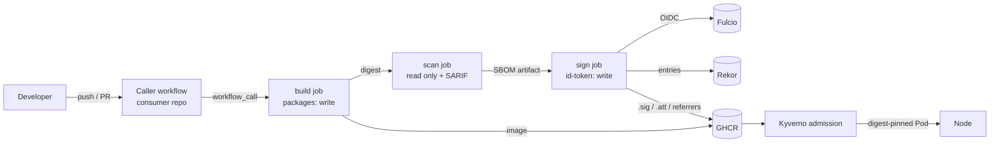

# Threat model

This document covers the path from a commit in a consuming repository to a
running Pod admitted by the Kyverno policy. It lists what the pipeline
defends against, what it does not, and how each control maps to the
[SLSA v1.0 Build track](https://slsa.dev/spec/v1.0/levels).

## Scope and assets

| Asset | Why it matters |
|---|---|
| Source at the built commit | Everything downstream claims to describe it |
| Image manifest digest | The only identifier the policy trusts; tags are mutable |
| Signing identity (Fulcio certificate SAN) | Binds a signature to `supply-chain.yml@<ref>` |
| SBOMs (SPDX, CycloneDX) | Inventory used for the gate and for later CVE triage |
| Provenance predicate | Records source, builder, parameters and run |
| GHCR namespace | Where images and attestations live |

Out of scope: compromise of GitHub itself, Sigstore public-good
infrastructure (Fulcio, Rekor), and the cluster control plane. They are
trusted roots, and the trust is stated rather than assumed silently.

## Trust boundaries

The boundary that matters most is between the caller workflow and the
reusable workflow. The caller chooses inputs, but the steps that run, the
action versions and the signing identity are fixed by the reusable
workflow at the ref the caller pinned. Fulcio records that ref in the
certificate (`job_workflow_ref`), and the admission policy matches on it.

## Threats and controls

STRIDE categories are noted where they help. "Residual" is what remains
after the control.

| # | Threat | Control | Residual |
|---|---|---|---|
| T1 | Image pushed to GHCR outside the pipeline (stolen PAT, developer laptop) | Policy requires a signature whose SAN is this reusable workflow on `main` or a release tag. A hand-pushed image has no such certificate. | An attacker with write access to *this* repository's `main` can change the workflow. Protect it with branch protection, required reviews and CODEOWNERS. |
| T2 | Tag moved to a different image after verification (Tampering) | Policy uses `mutateDigest` and `verifyDigest`; the Pod spec is rewritten to the verified digest. Verify script refuses tag references. | None for admitted Pods. |
| T3 | Caller forks the reusable workflow and signs with it (Spoofing) | The fork's SAN is `github.com/<fork>/...`, which fails the subject regex. Provenance `builder.id` is checked separately in `verify.sh`. | Consumers who loosen the regex lose this. |
| T4 | Caller passes hostile inputs (build args, context path) | Inputs reach shell only through `env:`, never by `${{ }}` interpolation inside `run:`. Build args are recorded in provenance so they are auditable. | The caller still controls the Dockerfile and source; provenance describes a malicious build faithfully. That is by design: SLSA attests *how* something was built, not that the source is benign. |
| T5 | Compromised third-party action (tj-actions style tag rewrite) | Every `uses:` is pinned to a full commit SHA with a version comment; CI fails on unpinned references. Renovate or Dependabot can bump SHAs through reviewed PRs. | A malicious commit that is reviewed and merged is still trusted. |
| T6 | Build step exfiltrates the OIDC token and signs arbitrary images (Elevation) | `id-token: write` is granted only to the `sign` job, which never runs the caller's Dockerfile or code. The `build` job has no OIDC permission. | A compromised action *inside* the sign job (cosign-installer, checkout, attest) could misuse the token. Those are pinned and few. |
| T7 | Known-vulnerable image reaches production | Grype gate on the SBOM fails the run at the configured severity before signing; unsigned images are rejected at admission. SARIF lands in code scanning. | Zero-days and vulnerabilities absent from the Grype DB at build time. The SBOM attestation makes retroactive scanning possible. |
| T8 | Scanned artifact differs from shipped artifact | The gate scans the same SPDX SBOM that is attested, generated from the pushed digest. | Syft cataloger gaps (e.g. statically linked binaries without build info) leave packages out of the SBOM entirely. |
| T9 | Attestations stripped or replaced in the registry (Repudiation) | Signatures and attestations are recorded in Rekor; Kyverno and `cosign verify-attestation` check the transparency log inclusion. Deleting `.att` causes admission to fail closed. | Denial of service by an actor with registry delete rights. |
| T10 | Image pushed but job fails before signing | It stays in GHCR unsigned and is rejected by the policy. | Registry clutter; a retention policy cleans it up. |
| T11 | Self-hosted runner persistence between jobs | `runs-on` defaults to GitHub-hosted ephemeral runners; the provenance records `runner_environment` and the policy requires `github-hosted`. | A consumer overriding `runs-on` to a self-hosted label fails admission until the policy is changed deliberately. |
| T12 | Policy bypass via excluded namespaces | Only `kube-system` and `kyverno` are excluded. | Anyone who can create Pods there bypasses the policy; restrict with RBAC. |

## SLSA Build track mapping

| Requirement | Level | How it is met | Evidence |
|---|---|---|---|
| Provenance exists | L1 | `slsaprovenance1` attestation via cosign, plus GitHub `attest-build-provenance` | `cosign verify-attestation --type slsaprovenance1` |
| Provenance is complete (builder, source, parameters, run id) | L1 | `provenance.sh` emits `buildDefinition` and `runDetails` | `tests/provenance_test.sh` |
| Hosted build platform | L2 | GitHub-hosted runners, recorded in `internalParameters` and checked by policy | Kyverno condition on `runner_environment` |
| Provenance is signed by the build platform | L2 | Keyless signature tied to the workflow identity issued by GitHub OIDC and Fulcio | Certificate SAN check in `verify.sh` and policy |
| Provenance is unforgeable by tenants | L3 (partial) | Signing runs in a separate job of a reusable workflow; the caller cannot inject steps there, and only that job holds `id-token: write`. GitHub's own `attest-build-provenance` attestation is generated with the same isolation. | Permissions block per job |
| Build runs are isolated from one another | L3 | Ephemeral GitHub-hosted VMs per job | Platform property |

### Where this stops short of L3

- The `provenance.sh` predicate is generated by a step in the same workflow
  run as the build, so its contents are as trustworthy as the reusable
  workflow's code. The GitHub-generated provenance (`gh attestation verify`)
  comes from the platform and is the stronger statement; `verify.sh` checks
  it when `VERIFY_GH_ATTESTATIONS=1`.
- The Buildx cache (`type=gha`) is shared between runs of the same
  repository, including pull requests. A poisoned cache entry from a PR
  could influence a later main-branch build. Teams that need strict L3
  should drop `cache-from` on protected-branch builds or scope cache keys.
- `slsa-framework/slsa-github-generator` produces L3 provenance through a
  separate trusted builder. It cannot be pinned by SHA (it verifies its own
  tag at runtime), which conflicts with T5. This pipeline keeps SHA pinning
  and documents the gap instead.

## Operational guidance

- Pin the reusable workflow in callers by SHA or by a release tag and let
  the policy accept only `main` and `vX.Y.Z` refs.
- Protect `main` and release tags in this repository; they define the
  signing identity.
- Keep the Grype DB current (the action downloads it per run) and rescan
  stored SBOMs on a schedule for new CVEs.
- Monitor Rekor for unexpected entries with this workflow's identity, for
  example with `rekor-monitor`.
